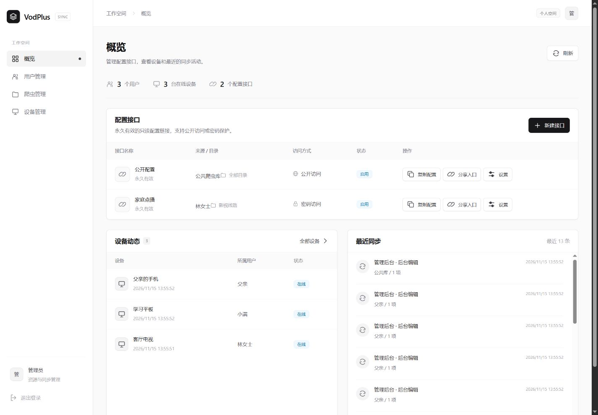

# VodPlus Sync

运行在 Cloudflare Workers 上的爬虫管理与人物数据同步平台。用一个简洁后台管理家人的本地资源、观看记录、设备和带密码的配置接口。

- **人物隔离**：后台预建用户，只需一次性设备码即可绑定，也可从后台一键打开 App 绑定。观看历史、进度、搜索和配置分别归属各人物。
- **文件管理**：每一级目录优先的文件列表，目录默认收起并支持一键展开/收起；黄色文件夹与真实文件类型图标，支持多种排序。桌面行内操作、小屏下拉菜单，点击标题弹窗编辑；拖放批量上传可选择目录、覆盖或重命名避让。保留移动、停用、回收站、版本与冲突处理。
- **按变化同步**：完整文件上传，SHA-256 校验，版本比较、幂等回执和游标增量；无长连接。
- **只读分享**：配置链接永久有效；密码可留空公开访问，设置时最低 5 位。脚本、子线路和嵌套配置沿用对应访问方式。
- **公共爬虫库**：可独立发布，也可显式复制给用户；复制后各自维护。
- **轻量部署**：Workers 提供接口和静态后台，D1 同时保存元数据和文件内容；没有常驻应用服务器。

## 开始使用

需要 Node.js 22+（本地开发时）和 Cloudflare 免费账户。**无需 R2，无需为本项目填写 R2 支付资料。**

```text
npm ci --ignore-scripts
npm run db:local
npm run dev
```

首次打开服务时，如果没有管理员，会直接进入创建账号页面。设置管理员账号和至少 **5 位密码**即可，无需配置初始化密钥。已有管理员时显示登录页。

登录后：创建人物 → 生成设备码 / 一键绑定 → 上传资源 → 按需发布配置接口。ys App 同步由对应 Android 项目接入，本仓库维护服务端与 [App 接入协议](docs/APP_INTEGRATION.md)。

在“爬虫管理 → 同步规则”设置所有用户默认同步的文件类型。默认 `py/js/txt/json/m3u8/jar/php/html` 及无后缀文件；默认跳过 `_cache`、`__pycache__`、`pycache` 目录及整个子树。修改规则不会删除已有文件。

设备管理点击设备名可读取点播、直播、主题和壁纸的当前回报，单独下发修改并等待 App 应用确认。需要配套 App 接入，接口与回报约定见 [设备控制](docs/DEVICE_CONTROL.md)。

右上角头像或“账号与数据”可修改管理员密码；左侧独立的 **服务重置** 菜单可在网页确认后清空全部数据并重新初始化。重新部署本身保留原 D1 和管理员。操作说明见 [账号与服务重置](docs/ACCOUNT_RECOVERY.md)。

## 部署到 Cloudflare

仓库发布后可使用 Cloudflare 官方 Deploy 按钮，创建 Worker，并自动复用或创建 D1、执行迁移。具体要求见 [部署说明](docs/DEPLOY.md)。

<!-- deploy-button:start -->
[](https://deploy.workers.cloudflare.com/?url=https%3A%2F%2Fgithub.com%2F0o755%2Fvodplus-sync)
<!-- deploy-button:end -->

源码仓库：[0o755/vodplus-sync](https://github.com/0o755/vodplus-sync)。已有该仓库的使用者，请在 Cloudflare 将现有 Worker 直接关联此仓库的 main 分支；以后推送会自动更新。上面的按钮用于首次安装，会复制一份仓库，不是日常重新部署入口。

## 文档

新版界面使用 Tailwind CSS，采用中性灰白配色、紧凑表格和统一弹窗：



[发布弹窗预览](docs/ui-publish.jpg) · [文件列表预览](docs/ui-files.jpg) · [上传弹窗](docs/ui-upload.jpg) · [设备配置弹窗](docs/ui-device-config.jpg)

| 文档 | 内容 |
|---|---|
| [部署](docs/DEPLOY.md) | 现有仓库自动部署、首次安装、本地开发与升级 |
| [使用](docs/USAGE.md) | 用户、设备、文件、公共库和配置分享 |
| [架构](docs/ARCHITECTURE.md) | 权限、事务、冲突、存储生命周期与当前边界 |
| [同步协议](docs/PROTOCOL.md) | 绑定、上传、提交、游标、记录身份与错误处理 |
| [App 接入](docs/APP_INTEGRATION.md) | ys 接入点、队列隔离、原子落盘、扫描停用与日志 |
| [设备控制](docs/DEVICE_CONTROL.md) | 四项设备配置、实时回报、指令确认和已有身份保护 |
| [账号恢复](docs/ACCOUNT_RECOVERY.md) | 修改密码、完整重置、忘记账号与结构诊断 |
| [图标来源](docs/ICON_SOURCES.md) | 本地文件类型 SVG 与 MIT 许可 |
| [参考客户端](examples/sync-client.js) | 可测试的传输实现及宿主适配器边界 |
| [验证记录](docs/VALIDATION.md) | 本地集成测试与浏览器验收范围 |

## 项目结构

```text
src/             Worker 路由、认证、同步与分享模块
web/             后台页面模块与编译后的静态资源
styles/          Tailwind CSS 入口、控件与工作区样式
migrations/      D1 有序迁移
examples/        App 协议参考实现
tests/           workerd + D1 集成测试与部署流程回归
scripts/         检查、部署、临时预览和发布准备
docs/            运维、使用与接入文档
```

## 验证

```text
npm run check
npm test
npm run build
```

`build` 仅 dry-run 打包，不创建线上资源。GitHub Actions 在推送和 PR 时执行同样检查。`node scripts/preview.mjs` 为本地界面验收创建可丢弃的内存数据，仅监听 `127.0.0.1:8799`；它不是部署入口。

当前定位是家庭或小范围使用的第一版。单文件上限 1.5 MiB，每个空间最多 5000 条实体（包括删除记录），目录单次批量操作最多 80 项。历史浏览显示最近 20 版；为长期离线设备保留增量记录和内容，暂不自动清理历史内容。免费 D1 单库上限为 500 MB，包含文件、历史、元数据和索引；文件内容采用 Base64 小块存储，有约 1/3 编码开销。详细容量边界见架构文档。

尚未选择开源许可证；公开 GitHub 仓库前请由仓库所有者确定授权方式。
