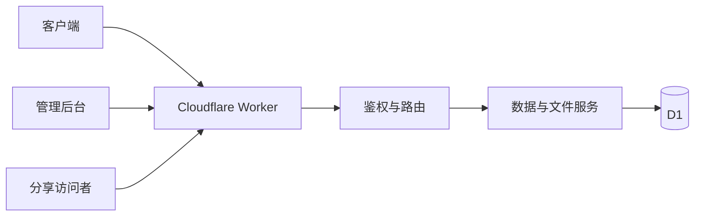

# 架构说明

## 请求流

Worker 同时提供 HTTP API 和管理页面。D1 保存用户、设备、JSON 记录、文件内容、版本历史及同步会话。

## 模块

| 目录或文件 | 职责 |
| --- | --- |
| `src/worker.js` | 请求分发、错误响应和安全响应头 |
| `src/auth.js` | 管理员登录、设备绑定和鉴权 |
| `src/generic/` | 数据推送、文件发布、清单确认和恢复 |
| `src/sync/` | 实体存储、版本记录和同步规则 |
| `src/storage/` | 文件内容分块、读取和去重 |
| `src/devices/` | 设备配置与回报 |
| `src/shares.js` | 只读分享和资源访问 |
| `src/schema/` | 数据库结构检查与补齐 |
| `src/maintenance.js` | 过期会话和短期日志清理 |
| `web/`、`styles/` | 管理页面与 Tailwind 样式 |
| `migrations/` | 数据库结构变更 |
| `examples/` | 客户端接入示例 |

## 身份与数据隔离

管理员通过 Cookie 会话管理服务。设备通过 Bearer 令牌访问绑定用户的数据；用户身份从令牌解析。

同一用户下，结构化数据按 `namespace + key` 定位，文件按相对路径定位。多个应用可以使用独立命名空间保存各自的数据。

公共库使用独立空间。分享凭证仅能访问指定发布范围，不具备设备同步权限。

## 存储模型

| 数据 | 存储位置 |
| --- | --- |
| 当前记录、文件和目录元信息 | `entities` |
| 版本快照与变化记录 | `versions`、`changes` |
| 文件元信息与分块内容 | `file_contents`、`file_chunks` |
| 请求幂等回执 | `receipts` |
| 完整推送会话与清单 | `publish_sessions`、`publish_items` |
| 上传摘要及比对状态 | `publish_checks` |
| 设备已确认持有的项目 | `device_contents` |
| 用户空间修订 JSON、设备确认摘要 JSON | `sync_heads`、`device_sync_summaries` |
| 恢复会话、快照和分包 | `restore_sessions`、`restore_snapshots`、`restore_items` |
| 设备恢复基线与已知项目 | `restore_baselines`、`restore_known` |

文件内容按用户与摘要去重，内部使用 192 KiB 分块和 Base64 编码。客户端按完整文件上传和下载。

## 推送事务

记录和文件以服务器提交顺序更新。相同操作标记和相同请求内容返回同一结果，内容变化时需要使用新的操作标记。

完整推送先比对内容摘要，一致项直接计入清单，只传输不同的正文。`finish` 会再次核对已比对内容的当前状态，存在未传内容或并发变化时返回补传列表。

全部项目就绪后，才删除指定范围内未出现的项目。确认删除时同时检查文件规则，排除项保持不变。

实体更新、版本历史和变化记录由数据库事务及触发器共同完成。

## 恢复事务

空间的文件修订和各数据分区修订合并保存在一行 JSON 中，与实体修改同事务更新。设备成功发布或恢复后保存确认摘要。

开始恢复时先比较所选分区的紧凑状态。内容和文件规则均未变化时，只创建轻量空会话，不复制逐项快照或重建持有记录；设置变化不会使未变化的文件范围失效。

需要应用变化或指定完整恢复时，在 D1 内建立固定快照，并与设备上次成功确认的状态比较。恢复包每页最多 25 项，文件内容通过单独请求读取。

客户端完成本地应用后发送 `ack`，服务端才提交恢复基线。未确认就重新开始时，执行完整恢复，并补发必要的删除通知。会话标记与用户、设备和同步范围绑定。

成功推送和恢复会记录设备持有的具体项目。普通恢复可跨范围复用这些记录，跳过内容未变化的项目；显式完整恢复始终下发全部内容。开始应用恢复时先失效对应持有记录，避免中断后错误地认为本机内容完整。

完整恢复只影响所选数据分区和服务端已知文件。未进入云端管理范围的本地文件保持不变。

## 生命周期与容量

恢复确认分别使用文件路径、数据分区与记录键、实体主键索引查找。文件路径检查使用大小写折叠索引；未变化的设备持有状态和恢复已知项目不重复删除重建。

D1 读取额度按扫描行计数。新增联查应检查执行计划和真实 `rows_read`，避免多项目之间的重复全表扫描。

定时任务每天 03:17 UTC 清理过期登录会话、设备码、传输会话和短期日志。文件内容、版本变化及必要的恢复基线保留。

单文件上限为 1.5 MiB，每个空间最多 5000 条实体。内容编码、索引、历史和恢复快照均计入 D1 容量。套餐额度见 [部署指南](DEPLOY.md#免费额度与容量)。
